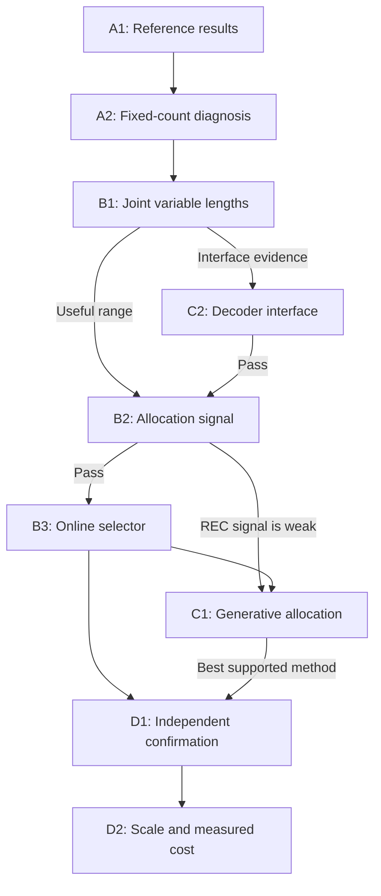

# 1 Joint adaptive tokenization and generation

**Research plan · 23 October 2026 · Version 1.0**

Train an image tokenizer, an image-specific token selector, and a latent generator in one training run. Start from UNITE and transfer the supervised allocation idea from KARL. Test whether useful allocation survives a fixed average token budget, joint training, and generation from noise.

**Recommended first route:** A1 → A2 → B1 → B2. These nodes establish the references, classify the low-token problem, and measure whether image-specific allocation has enough value to justify learning a selector. B3 builds the joint adaptive system. C1 tests the strongest proposed contribution: allocation that considers both reconstruction and generative error. C2 is a conditional interface experiment. D1 and D2 confirm the result.

This is an experiment protocol, not a report of completed model runs. Code and paper inspection are complete enough to define the experiments. Checkpoint bytes, dataset files, package installation, and GPU speed have not been verified here. All proposed thresholds and GPU limits are project decisions, not predicted results.

## 1.1 The intended contribution

The main question is:

> Can image-specific capacity allocation improve a shared tokenizer–generator under a fixed token-count distribution?

A stronger result would show that reconstruction error alone gives the wrong assignments. The proposed selector would then use the effect of denoising errors after image decoding.

The target is **joint learning from random initialization**, with both reconstruction and generation losses active from the first update. A common warm start is permitted for screening. It cannot establish the final from-scratch claim. Hard token selection is trained with online supervision; the first method does not differentiate through the discrete selection itself.

## 1.2 What the reported 16-token result does and does not imply

The user reports poor training and poor final quality when every image has 16 tokens. Treat this as an unpublished observation. Its exact model, loss implementation, training duration, and meaning of “diverges” are not yet known.

Several explanations remain possible:

1. Some images need more capacity than others.
2. Almost all images need more capacity at this model size and training budget.
3. The shared reconstruction and generation tasks interfere during training.
4. Loss scale, noise, token positions, or a code path changes when the count changes.
5. Training is stable but has not converged within the observed budget.

A rising latent denoising loss alone does not establish divergence. The target distribution also changes during joint learning. Use the outcome classes in Section 5.10.

**A mathematical constraint:** if `K >= 16` and `E[K] = 16`, then `K = 16` almost surely. An adaptive mean-16 experiment must allow some images to use fewer than 16 tokens.

# 2 Terms and fixed names

| Term | Meaning in this plan |
|---|---|
| Tokenizer | Network that maps an image to latent vectors. |
| Generative encoder, GE | UNITE network shared by tokenization and latent denoising. |
| Selector | Small network that chooses the number of retained tokens. |
| Candidate count | Number of registers processed before selection. |
| Active count | Number of latent vectors retained after selection. |
| Prefix | The first `k` tokens in a fixed order. |
| Distortion | A specified difference between two images. |
| Counterfactual score | Error obtained by evaluating another allowed token count. |
| Oracle assignment | Assignment computed from measured counterfactual errors. It is a diagnostic, not the deployed selector. |
| Joint training | Tokenizer and generator receive updates in the same training run. |
| Staged representation training | Train the encoder/decoder first, freeze them, then train the generator. The node states whether the selector also trains. |
| EMA | Exponential moving average of model parameters. |
| gFID / rFID | FID of generated / reconstructed images. Lower is better. |
| NFE | Number of denoiser function evaluations. |
| Matched histogram | Exactly the same number of images at each token count. |
| Positive reference | A verified established result under its applicable configuration. |
| GPU-hour | One reserved GPU for one hour, including evaluation and failed runs. |
| Rate proxy | Token count at fixed latent width and numerical format; not compressed bits. |

Use these hypothesis IDs:

| ID | Hypothesis | Main test |
|---|---|---|
| `H_ALLOC` | Image-specific allocation improves the joint model beyond random length variation. | B2 → B3 |
| `H_GEN` | Allocation based on reconstruction and decoded denoising error improves generation over reconstruction-only allocation. | C1 |
| `H_CONFLICT` | Low capacity increases conflict between the shared tasks on particular images. | Small probes in A2, B3, and C1 |
| `H_INTERFACE` | A shared prefix loses quality because the decoder interprets the same registers differently at different lengths. | Conditional C2 |

Use the method IDs in the node tables. Append the seed and configuration hash to the run ID, not to the method name.

# 3 Prior work and novelty limits

## 3.1 What the two primary methods supply

UNITE supplies a shared tokenizer–denoiser and a joint reconstruction/generation training loop. The clean latent target is detached before the denoising pass. Both tasks still update shared parameters. [S1], [S2]

KARL supplies supervised, image-dependent allocation. Its training uses an achieved reconstruction error to supervise which slots to keep in a second pass. Its released gate can retain noncontiguous positions. A count alone therefore does not fully describe a KARL representation. [S6], [S7]

This plan uses continuous UNITE latents and a contiguous prefix. It transfers KARL’s allocation principle, not its complete pretrained tokenizer or arbitrary slot masks. Call the proposed model `ADAPT_REC` or `ADAPT_GEN`. Do not call it unchanged KARL.

## 3.2 Closest comparisons

| Prior work | Relevant established idea | Role here |
|---|---|---|
| UNITE [S1]–[S5] | Shared joint tokenization and latent generation. | Main implementation and fixed-count baseline. |
| KARL [S6]–[S8] | Single-pass, error-conditioned adaptive tokenization. | Positive allocation reference and supervision design. |
| ALIT [S9] | Recurrent allocation of image tokens. | Background; no full reproduction is required. |
| FlexTok [S10] | Ordered variable-length representations and a generative decoder. | Prefix baseline precedent; token counts across architectures are not equal information budgets. |
| Learnable Global Merging, LGM [S11] | Variable-length diffusion and representation alignment across lengths. | Closest external diffusion comparison. Its joint-length training is distinct from joint tokenizer–generator training. |
| STAT and AdaTok [S12], [S13] | Learned image-dependent counts and ordered token representations. | Rule out “learning the count” as sufficient novelty. |
| DC-DiT [S14] | Adaptive token computation inside diffusion. | Compare scope: persistent image representation versus temporary denoiser compression. |
| KATok [S15] | Continuous adaptive video tokenization and generation of position information. | Supports the need to specify a generative length or mask distribution; the data domain differs. |
| EOSTok [S16] | Joint tokenizer–generator training with decoded generative feedback. | Decoded error itself is established; allocation using it is the proposed test. |
| NesTok [S17] | Training and alignment across full and short representations. | A generic full-to-short consistency loss is not a new contribution. |

**Candidate publication claim:** generation-aware, image-specific capacity allocation improves joint shared-weight learning under matched token distributions and measured compute.

The literature search supports testing this narrower claim. It does not establish priority. Before submission, repeat a focused search on the exact successful mechanism. Do not expand the pilot into reproducing every related method.

## 3.3 Why these tests can produce a new result

For a fixed representation, let `C(x,k)` be a measured image cost at count k. An average-rate allocation problem has the form

$$
\min_{q}\ \mathbb E_x[C(x,q(x))]
\quad\text{subject to}\quad \mathbb E_x[q(x)]\leq\bar K.
$$

Here q maps an image to an allowed count and `bar K` is the target mean. A Lagrange price lambda gives the independent rule `argmin_k[C(x,k)+lambda*k]`. The useful signal is the **change in cost per additional token**. Absolute image difficulty alone is insufficient. An image with high error may gain almost nothing from more tokens. The counterfactual table measures these differences directly.

This derivation holds with the model fixed. During joint training, the cost table changes because the representation, decoder, and generator all change. The online selector tests whether it can track these changes. It is a supervised approximation to a changing allocation problem, not a proof of convergence of the full training procedure.

H_ALLOC requires variation between images in the value of extra capacity. It does not follow from poor fixed-16 quality. A random mixture can also change the optimization problem. The same-histogram shuffled control removes this explanation while preserving the amount of long-code exposure.

H_GEN adds a second reason to allocate capacity: codes that reconstruct well can still be difficult for the shared denoiser to model. A raw latent error can change under a rescaling of latent coordinates. The decoded probe in C1 is tied to an observable image error. It can reveal different assignments even when reconstruction-only allocation has little signal. Actual sample quality must confirm the hypothesis; the probe is not a likelihood or a surrogate guarantee for FID.

H_CONFLICT supplies a possible mechanism. At low count, reconstruction and denoising may require different updates to the shared weights. Allocation could reduce pressure on the images with the largest conflict. The small gradient probes test this association. They do not justify adding gradient surgery or several new loss terms before the allocation effect exists.

# 4 Decision tree

| Node | Question | Continue when | Otherwise |
|---|---|---|---|
| A1 | Can the two required reference effects be verified? | Applicable reference passes. | Diagnose or mark the affected route blocked. |
| A2 | What kind of failure occurs at fixed 16? | A valid stable high-count control exists. | Resolve reference or numerical problems first. |
| B1 | Does one joint model support several lengths? | The common prefix model supports a useful quality range. | C2 if the interface is implicated; otherwise stop this configuration. |
| B2 | Is there useful image-specific reconstruction allocation signal? | Held-out benefit over shuffled assignments; attainable mean budget. | Stop REC at that budget, test the one relaxed budget, or screen GEN in C1. |
| B3 | Can an online selector retain that benefit during joint training? | Better generation or a clear quality/cost gain over matched controls. | Classify selector failure versus lack of allocation benefit. |
| C1 | Does generative error improve the allocation rule? | Better actual generation than reconstruction-only allocation. | Retain the simpler reconstruction-only method. |
| C2 | Does a different decoder input interface resolve a measured cross-length problem? | Matched controls improve without hidden extra information. | Stop the interface branch. |
| D1 | Does the result survive seeds, deployment selection, and a staged baseline? | The main claim survives all required controls. | Narrow the claim or stop scaling. |
| D2 | Does the effect survive ImageNet-1K scale and cost measurement? | Confirmed quality/cost result and a defensible comparison. | Report the measured limit. |



Independent work may proceed together when prerequisites and the total allocation permit. For example, A1’s two references can run together. C1 and C2 can overlap only if each has its own required evidence. Do not run every optional branch automatically.

# 5 Shared protocol

## 5.1 Source locks and artifact status

| Artifact | Fixed source or identifier | Status |
|---|---|---|
| UNITE code | `ShivamDuggal4/UNITE-tokenization-generation@2389f2c65fedbd43ada851e69b2b810efd23af7d` | Inspected public commit. |
| UNITE reference | `UNITE-B.pt`, official README checkpoint; Base/Base, 240 epochs | Link exists; bytes and SHA-256 must be obtained. |
| KARL code | `ShivamDuggal4/karl@5c1a5693edf87228f988f363b2acdb7eb826a889` | Inspected public commit. |
| KARL reference | `imagenet100/karl_small_vqgan_quantized_latents.pth` in the official download registry | Link exists; bytes and SHA-256 must be obtained. |
| KARL base image tokenizer | The VQGAN checkpoint/config selected by that same registry and loader | Resolve and hash before A1. |
| ImageNet classes for pilot | `run_scripts/create_imagenet100.py` at the KARL commit | Use its exact 100 synsets. |
| LGM code | `movinghoon/lgm@b189c2ce44ee22b1c605a12ad0091bc317810a16` | Official source inspected; D2 uses its corrected XL release. |
| LGM reference | `movinghoon/LGM` files `tokenizer.pt` and `xl.pth`; dataset `movinghoon/ours2-d32` | Resolve immutable HF revisions and byte hashes before D2. |
| ImageNet source | ILSVRC2012 train and validation archives | Record archive hashes and extraction manifest. |
| Full-scale FID reference | JiT `cbc743a2ada5e9762697da2c83f8c4f8379e8c17`, `fid_stats/jit_in256_stats.npz` [S18] | Published artifact identified; downloaded-byte SHA-256 still required. |
| Inception metric weights | `weights-inception-2015-12-05-6726825d.pth`, official torch-fidelity compatibility asset | Download through its official package/release; hash bytes before A1. |

Keep reference checkouts unchanged under `third_party/`. Put wrappers and patches in the project tree. Save their hashes. Existing verified artifacts can satisfy a reference gate when their source, data, metrics, and configuration match.

Create `locks/artifacts.json` with source commits, checkpoint SHA-256 values, data manifest hashes, metric weight hashes, environment lock, and each applied patch. Unresolved fields block only the experiment that needs them. Never substitute a changing branch name or invent an artifact hash.

`COMMON_PREFIX` is the complete model/optimizer/EMA snapshot from B1's `RANDOM_QUOTA` endpoint. If C2 changes the interface and passes, its `QUERY_RANDOM_QUOTA` endpoint becomes the new `COMMON_PREFIX`. Record the producing node and hash. All dependent screens use that exact snapshot.

## 5.2 Source details that change the experiment

The following are findings from the pinned source, not assertions about the user’s unpublished ablation.

| Finding | Required action |
|---|---|
| UNITE’s encoder ends with a fixed `:256` slice. At a smaller register count, image-patch outputs can enter the returned tensor. [S3] | Record the register length before adding patches; return exactly that many register outputs after removing context tokens. Verify unchanged output at 256. |
| The decoder reshapes latent count to a square grid, then interpolates to 16 × 16. [S4] | Start with `KSET = [4,16,64]`. Counts such as 8 or 32 need a different interface. |
| The decoder still processes 256 image tokens plus its class token. [S4] | Do not infer proportional decoder savings from fewer latents. |
| The public UNITE YAML uses 3 denoising draws, while the released headline checkpoints used 14. [S2], [S5] | Separate `PILOT_M3` from the checkpoint reference. Never compare them as the same training recipe. |
| The source sums denoising draws, uses velocity-weighted error, and uses a mixture for reconstruction noise. [S3] | Use the equations below; do not substitute the paper’s simplified loss description. |
| Source learning rates are scaled by batch size; its schedule counts can differ from optimizer updates under accumulation. [S5] | Log executed learning rates. New experiments use an explicit update-based schedule. |
| KARL’s gate is not necessarily a prefix; its evaluation wrapper has incomplete paths. [S7] | Use the original gate for the reference. Use an isolated evaluation adapter; do not import that mask directly into the new generator. |

A source fix must preserve the published 256-token path. A successful fix is an implementation result. It does not establish a research hypothesis.

## 5.3 Environment, precision, and hardware

For new UNITE experiments, use Python `3.10`, `torch==2.10.0` with CUDA `12.8`, `torchvision==0.25.0`, `timm==0.9.16`, `torchdiffeq==0.2.5`, `transformers==4.56.2`, `omegaconf==2.3.0`, `numpy==1.26.0`, `scipy==1.15.3`, `einops==0.8.1`, `lpips==0.1.4`, `PyYAML==6.0.2`, and `torch-fidelity==0.3.0`. These are proposed pins based on the source requirements, not a tested environment. Freeze the exact wheel set before model runs. Resolve remaining transitive dependencies once.

Run the KARL checkpoint reference in its separate supplied environment if necessary. Do not force an unrelated environment migration before the reference evaluation.

Use H100 80 GB as the budget reference. H200 and A100 80 GB are permitted. Use the same GPU model within each timing comparison. RTX 4090 is permitted for small evaluations or a compatible microbatch. V100 is not the main training route: it requires a separate compatible precision/software configuration. Blackwell is not required.

Store model weights and optimizer states in FP32; use BF16 autocast for model operations. Compute losses, normalization statistics, gradient norms, and selector scores in FP32. Accumulate reported scalar sums and feature covariance statistics in FP64. Disable TF32 in new project runs and paired numerical checks. Do not require bitwise-identical distributed training.

Seed Python, NumPy, PyTorch CPU, and all CUDA generators. NumPy matters because the source time sampler uses SciPy. Use training seeds `0` for screening and `1,2` for confirmation. Use evaluation seed `20261023` and bootstrap seed `917`. Derive independent RNG streams for data order, image flips, encoding noise, reconstruction noise, diffusion noise, time draws, and assignment shuffling.

Draw image noises in the original image order at 64 positions, then slice and group them. Use the same prefixes for paired counts and arms. Draw class-dropout masks and times before count grouping. Selector probes use a separate RNG stream. The 256-token reference keeps its native random draws.

## 5.4 Data splits and preprocessing

Use 256 × 256 images. For new experiments, use the pinned UNITE `CenterCropTransform(256)` and convert pixels to `[0,1]`. Training adds a horizontal flip with probability 0.5. Evaluation has no flip.

Preserve the source training convention: real images in `[0,1]` and raw, unclamped reconstructions enter its frozen VGG LPIPS module directly. The module does not convert that range to `[-1,1]`. For new experiments, set this LPIPS module to `eval()` after every `model.train()` call. This disables its dropout. Record this common deviation from the source training behavior. A1 preserves the reference evaluation path. [S3], [S5]

For all project reporting and selector scores, clamp decoded images to `[0,1]` first. External AlexNet LPIPS receives `2*x-1` for both inputs. For Inception features, use the source conversion `(x*255).clamp(0,255).to(torch.uint8)`. It truncates; it does not round. Use the same conversion for every candidate and control. Label source-specific KARL metrics separately.

For each ImageNet class, sort training images by SHA-256 of `"split-v1|" + synset + "/" + filename`:

| Split | Per-class rows | Use |
|---|---|---|
| `DEV` | First 32 | Branch decisions and permitted operating-point selection. |
| `CONFIRM` | Next 32 | D1; do not inspect before the method is frozen. |
| `FIT` | All remaining | Model training and selector supervision. |
| `ALLOC` | First 32 within FIT | Selector price calibration and counterfactual diagnostics; remains training data. |
| `FINAL` | Official validation set | Final D2 reconstruction evaluation. |

Pilot runs use the official KARL 100-class list. Full runs use all 1,000 classes. Save exact paths and class-to-index mappings. Reference evaluation in A1 uses each paper’s own data protocol, not these modified training splits.

A1 may evaluate reference checkpoints on official validation images. Do not use candidate scores there to select a method. gFID against standard training-set statistics is a benchmark distribution comparison, not an unseen-image reconstruction test.

For pilot training, use global optimizer batches of 256: select 32 classes uniformly without replacement, then 8 FIT images per class. Maintain a shuffled queue within each class; reshuffle with the data RNG when exhausted. Shuffle the class order, keep each group of eight images together, and divide the batch into four distributed microbatches of 64. Each microbatch has eight classes. Each of four GPUs receives two complete class groups. All paired arms consume the same image/flip stream.

For D2, select 128 classes × 8 images = 1,024. Each of four distributed microbatches has 32 classes × 8 images = 256. Each of eight GPUs receives four class groups. This gives nontrivial within-class shuffle controls. Record this sampling choice as a deviation from ordinary ImageFolder shuffling.

## 5.5 Model, tensors, and positions

The base is UNITE Base/Base: GE width 768, 12 blocks, 12 heads; decoder width 768, 12 blocks, 12 heads; image patch size 16; latent width `d=32`. Preserve source GE attention, SwiGLU, normalization, time/class conditioning, and 32 in-context tokens inserted at block index 4. Construct `num_classes=100` for pilot/D1 and `num_classes=1000` for D2 and the UNITE reference. The source entry point hardcodes 1,000; the project wrapper must set this explicitly. Use no new pretrained visual encoder.

All external image tensors are `[B,3,256,256]`. B is the logical image count in the stated operation. Token tensors are batch first. A written projection is `x @ W + b`, with `W: [d_in,d_out]`. PyTorch `Linear.weight` stores `W.T`. Theta denotes shared GE/latent-normalization parameters, psi denotes decoder parameters, and phi denotes selector parameters. A bar over a model denotes its EMA.

| Symbol | Shape | Definition |
|---|---|---|
| `x` | `[B,3,256,256]` | Realized input images. |
| `y` | `[B]`, int64 | Class IDs; null class is `num_classes`. |
| `P` | `[B,256,768]` | Image patch embeddings. |
| `U` | `[B,64,32]` | Full normalized latent output in the prefix model. |
| `k` | `[B]`, int64 | Active count; one of 4, 16, 64. |
| `z_i` | `[k_i,32]` | `U[i,:k_i,:]`. |
| `m` | `[B,64]`, bool | `m[i,j] = (j < k_i)` for zero-based `j`. |
| `H` | `[B,64,768]` | Input to `encoder.final_layer.linear`, after its normalization and AdaLN modulation, restricted to register positions. |
| `a` | `[B,1536]` | Concatenated mean and standard deviation of H over registers. |
| `s_phi` | `[B,3]` | Predicted allocation costs in KSET order. |

The prefix encoder always processes 64 candidate registers. Native fixed-count controls process only their stated number. Preserve trainable register positional vectors and the source 1D rotary positions; use original register indices `0,...,k-1` in the denoiser.

In image-encoding mode, supply independent Gaussian register inputs `[B,K_candidate,32]` and source modulation times `tau ~ Uniform[0,0.01)`. Drop the class condition for every image. Image patches are visible only in this mode. Normalize its register output with N_theta to obtain U. Seed the encoding noise and tau per image for paired evaluation; do not replace them with zero without a new declared experiment.

For the prefix model, add a three-row length embedding to the denoiser vector `c=t_embed+y_embed`. Preserve the source context tokens derived from `y_embed`. Pass length through both `forward` and `forward_with_cfg`. Duplicate it identically in the conditional and null-class halves of CFG; class dropout must not remove length.

Add a separate three-row length embedding after both decoder projections: `up_sample_decoder`, then `decoder.decoder_embed`. Both tables are `[3,768]`, initialized to zero. The encoder receives no selected length; selection follows its one image pass. Give these tables to all prefix controls.

For the standard decoder, pass the physically retained prefix to the source interpolation operation. Interpret it as `sqrt(k) × sqrt(k)` in row-major order. Then use the unchanged 256-token decoder. This is a precise initial interface, not a claim that prefixes form optimal spatial grids.

Group samples by active count before denoising and decoding. Restore original image order afterward. Weight each group by its image count; skip empty groups. With R ranks, A accumulation steps, and n local images per microbatch, the optimizer batch is `B=R*A*n`. Backpropagate each local sum divided by `n*A`. Default DDP gradient averaging then gives the global image mean. Do not average count-group means equally.

Do not pass real images, their patch tokens, hidden encoder features, or source-image counts into generation. The selector features are used only when an input image exists.

## 5.6 Exact reconstruction and generation losses

Let `N_theta` be the source learned-affine LayerNorm over the final 32 channels. Use population variance, epsilon `1e-5`, and learned gamma/beta vectors `[32]` initialized to one/zero. It is shared across clean encoder output and denoiser prediction. Let `sg` mean stop-gradient.

Use this shared **allocation distortion**, with metric field `allocation_distortion`, on images clamped to `[0,1]`:

$$
\mathcal D_{\rm img}(x,x')=\operatorname{mean}|x-x'|
+\operatorname{LPIPS}_{\mathrm{AlexNet}}(2x-1,2x'-1).
$$

It differs from the source training loss and KARL's pixel-L1 request. Do not substitute one for another.

For image `i`, encode once and retain `z_i`. During reconstruction training, draw independent

$$
A_i\sim\operatorname{Bernoulli}(0.5),\qquad
T_i^{r}\sim\operatorname{Uniform}[0.7,1],\qquad
E_i^{r}\sim\mathcal N(0,I_{k_i d}).
$$

Use

$$
z_i^{r}=
\begin{cases}
T_i^{r}z_i+(1-T_i^{r})E_i^{r},&A_i=1,\\
z_i,&A_i=0,
\end{cases}
\qquad
x_i^{r}=D_\psi(z_i^{r},k_i).
$$

The reconstruction objective is

$$
L_r=\frac1B\sum_{i=1}^B\left[
\frac{\|x_i^r-x_i\|_1}{3\cdot256\cdot256}
+\operatorname{LPIPS}_{\rm source,VGG}(x_i^r,x_i)
\right].
$$

Both coefficients are 1. Keep training outputs unclamped. Use clean latents and the shared reporting clamp for reconstruction evaluation and selector labels.

For each image and denoising draw `r=1,...,M`:

$$
V_{ir}\sim\mathcal N(0,1),\quad
u_{ir}=\operatorname{sigmoid}(V_{ir}),\quad
t_{ir}=\frac{\alpha u_{ir}}{1+(\alpha-1)u_{ir}},\quad \alpha=0.5,
$$

$$
\bar z_i=\operatorname{sg}(z_i),\qquad
z_{ir,t}=t_{ir}\bar z_i+(1-t_{ir})e_{ir},\qquad
e_{ir}\sim\mathcal N(0,I_{k_i d}),
$$

$$
z_{ir}^{p}=N_\theta\!\left(GE_\theta(z_{ir,t},t_{ir},y_i,k_i)\right),
$$

$$
\ell_{ir}^{g}
=\frac{\|z_{ir}^{p}-\bar z_i\|_F^2}
{k_i d\,\max(1-t_{ir},0.05)^2},
\qquad
L_g=\frac1B\sum_{i=1}^{B}\sum_{r=1}^{M}\ell_{ir}^{g}.
$$

The total main-model loss is `L_r + L_g`. This preserves the source sum over denoising draws. Also log `L_g/M` for interpretation. Changing M changes both compute and effective loss weighting in the source; never treat it as a neutral microbatch setting. [S3]

For the causal pilot, `M=3` and the flow chunk size is 3. D2 retains M=3 unless an explicitly matched M=14 confirmation is funded. The published checkpoint reference uses its actual M=14 training metadata.

The clean latent branch gets no denoising gradient through its target or noised input. GE still gets denoising gradients through the second forward pass. Keep that distinction in code and reports. Source class dropout is 0.1 in denoising and 1.0 in encoding; do not drop the length condition.

## 5.7 Training configurations and schedules

`PILOT_M3` is an explicit project configuration, not a claim of exact paper reproduction.

| Setting | Pilot and D1 | D2 |
|---|---|---|
| Model | UNITE Base/Base; d=32 | Same |
| Data | ImageNet100 FIT | ImageNet1K FIT |
| Global batch | 256 | 1,024 |
| Default hardware | 4 × H100 80 GB | 8 × H100/H200 |
| Microbatch / accumulation | 16 per GPU / 4 | 32 per GPU / 4 |
| Main optimizers | Source Muon/AdamW parameter partition | Same |
| Muon | lr `1e-4`, momentum .95, eps `1e-6`, weight decay 0, `match_rms_adamw` | Same executed peak lr |
| AdamW | lr `1e-4`, betas (.9,.999), eps `1e-6`, weight decay 0 | Same |
| Gradient clip | Global norm 3.0 | Same |
| EMA decay per optimizer update | .9978 | Same |
| Denoising draws / chunk size | 3 / 3 | 3 / 3 |
| Selector optimizer | AdamW, lr `1e-3`, betas (.9,.999), eps `1e-8`, weight decay 0 | Same |
| Total updates | Node-specific | 150,000 |
| Warmup | 500 optimizer updates | 5,000 optimizer updates |
| Main LR after warmup | Constant `1e-4` during causal continuation screens | Cosine from `1e-4` to `1e-6` |
| D1 LR | Cosine to `1e-6` over its 30,000 updates | — |
| Train precision | BF16 autocast, FP32 weights | Same |
| Compile | Disabled in screens | Same setting for every measured method |

For update u=1,…,T, peak LR p, minimum LR m, and warmup W, use `p*u/W` through W. For a cosine stage after W, use `m+0.5*(p-m)*(1+cos(pi*(u-W)/(T-W)))`. For a constant stage, use p after W. The head LR is constant. Continuing a common checkpoint does not restart warmup.

Disable the entry point’s implicit learning-rate multiplier for new project runs. Register new parameters explicitly; the source parameter selector rejects unknown names. Put length embeddings and learned resampler queries in main AdamW. Put resampler projection matrices in Muon. Put the selector only in its separate AdamW optimizer; do not update it twice. Do not update frozen LPIPS weights.

The EMA includes GE, decoder, length embeddings, and selector. Update it after each main update and any selector update due at that step. Initial head fitting copies the fitted head into both live and EMA selectors. Online labels pair detached features from the current live image pass with target scores from the preceding EMA. Each label update uses only its 16 fresh pairs, with no replay buffer. This teacher lag is a declared approximation.

For shared-start branch comparisons, load the same model, optimizer, and EMA snapshot; keep the specified continuation LR fixed. For new parameters, start optimizer moments at zero. If memory requires a smaller distributed microbatch, declare it before the comparison, apply it to all arms, and recompute integer quotas and accumulation together. Do not silently change the assignment group or executed LR.

## 5.8 Allocation, quotas, and the deployed selector

Use `KSET=[4,16,64]`. The default operating point is `RATE16`.

| Active count | Images per pilot distributed microbatch | Images per optimizer batch | Probability |
|---:|---:|---:|---:|
| 4 | 32 | 128 | 0.5 |
| 16 | 24 | 96 | 0.375 |
| 64 | 8 | 32 | 0.125 |

Thus `E[K]=16` and `E[K^2]=616`. Fixed 16 has `E[K^2]=256`. Equal mean tokens do not imply equal attention work. Include context tokens and the fixed decoder in measured cost.

Solve assignments **within each distributed microbatch**, not across accumulated microbatches. Let `b` be its size and `S[i,j]` its measured or predicted cost for image i and count `KSET[j]`. Repeat cost column j by its quota to make a `b×b` matrix. Apply `scipy.optimize.linear_sum_assignment`. Sort rows by stable image ID and columns by count. Use the pinned SciPy tie behavior and save the result. No diminishing-return assumption is needed.

For training, all GPUs encode their local images once and retain only their local graphs. Gather the detached `[b,3]` cost matrix, solve the assignment on rank 0, and distribute counts. Decode and denoise physically grouped retained sequences. Each rank makes one backward call for its local image-weighted loss. Accumulate four such microbatches before the optimizer step. Do not retain four encoding graphs or add a hidden encoding prepass.

D2 uses `b=256` and quotas `[128,96,32]` per distributed microbatch. Its optimizer batch has quotas `[512,384,128]`.

Permit one fallback operating point, `RATE31_75`. It excludes count 4 and uses `[0,43,21]` in each pilot microbatch, or `[0,172,84]` per D2 microbatch. Its mean is **31.75**, not 32. The selector retains three outputs, but count 4 is excluded from assignment and price calibration. This fallback tests whether the forced use of 4-token codes caused a negative result. No second fallback is planned.

For B2 and C1 scoring, form fixed 64-image evaluation blocks. Sort classes by synset and each class's 32 images by split hash. For each of four rounds, take eight images per class, then place eight classes in each full block. The final block of each round has four classes and 32 images. This covers all 3,200 images and permits within-class shuffling. `RATE16` uses `[16,12,4]` for a 32-image block. For `RATE31_75`, the first two remainder blocks use `[0,22,10]` and the last two use `[0,21,11]`. The aggregate mean remains exactly 31.75. Record all block IDs.

The deployed selector uses the same encoded image pass. Compute a from detached H, with standard deviation `sqrt(mean((H-mean(H))^2)+1e-6)`. Use `Linear(1536,256) → SiLU → Linear(256,3) → softplus`. Initialize its two weights with Xavier uniform, gain 1, and biases with zero. Its outputs predict nonnegative costs. Fit the mean Huber loss, delta 1, between `log(1+s_phi)` and `log(1+target_score)`.

Independent single-image selection is

$$
k_\phi(x)=\arg\min_{k\in\mathcal K_{\rm active}}
\left[s_\phi(x,k)+\lambda k\right].
$$

Choose the smaller count at an exact tie. Use FP64 for price calibration and the final price-adjusted argmin. Fit one nonnegative lambda on ALLOC, then freeze it for DEV or CONFIRM. Enumerate all nonnegative action-change breakpoints `(s_a-s_b)/(b-a)` for distinct allowed counts a,b. Evaluate zero, each breakpoint, one midpoint between adjacent breakpoints, and one point above the largest. Use a sorted event sweep; update only rows affected by a crossing. Do not form an images-by-breakpoints matrix.

Choose the lowest mean predicted cost among operating points whose mean count is at most the target. Break remaining ties by larger mean count, then smaller lambda. If the mean undershoots by more than 2%, report the actual rate and compare at that rate. Never use held-out counterfactual errors to force its mean.

Quota assignment is a causal diagnostic, not independent single-image inference. Report both. No test-image counterfactual decode is allowed in the deployed result.

## 5.9 Generation without an input image

For prefix latents, the model defines

$$
p(x\mid y)=\sum_{k\in\mathcal K_{\rm active}}p_\eta(k\mid y)
\int p_\theta(z\mid k,y)\,p_\psi(x\mid z,k)\,dz.
$$

For a deterministic decoder, `p_psi` is its point-mass distribution. This is a valid sampling procedure; it is not a claim of exact maximum-likelihood training.

Estimate count probabilities from the adaptive candidate's FIT assignments, using add-one smoothing over its allowed counts:

$$
p_\eta(k\mid y)=
\frac{n_{y,k}+1}{\sum_{j\in\mathcal K_{\rm active}}n_{y,j}
+|\mathcal K_{\rm active}|}.
$$

Use the latest 4,096 training updates for intermediate pilot statistics. At each node's final evaluation, freeze the EMA model and EMA selector. Calibrate lambda on ALLOC, run independent selection on FIT once, then freeze its count table. Count this pass as training/calibration work. Report the class-balanced expected count after smoothing.

For the **candidate-versus-shuffled causal comparison**, use this one candidate-derived table for both models. The shuffled model does not have a valid image-specific selector. For its causal reconstruction evaluation, permute the candidate's held-out assignments within each class. For its independent deployment reconstruction, draw k from the same frozen class table, independently of the image. Report these two different policies separately. Do not run an untrained shuffled-control head.

Sample class y, count k from the table, and Gaussian noise `[k,32]`. Denoise at that fixed k, then decode. Paired candidate/shuffled generation uses exactly the same labels, sampled counts, Gaussian prefixes, solver, guidance, and image conversion. Other methods use their declared training or deployed count priors. Report their actual rate; a different prior is not a histogram-matched comparison.

This is generation by a model trained with content-adaptive tokenization. It does not discover the complexity of a future image before generating it. Forced-count sampling is a separate diagnostic: short-count conditioning can change the images produced within a class.

## 5.10 Metrics, outcome classes, and uncertainty

Report these stable field names:

Keep separate `training`, `reconstruction`, and `generation` metric objects in `results.json`. Rate gates compare matching workloads. Generation gates use the class-balanced expectation under the frozen deployed prior. Also report the realized sample mean. Candidate/shuffled generation must use the same realized counts. GEN/REC gates require their expected generation means within 2%; also report their held-out reconstruction rates.

| Field | Definition |
|---|---|
| `recon_l1` | Mean absolute image error on [0,1], equal weight per image. |
| `recon_lpips` | External LPIPS v0.1, AlexNet weights, inputs mapped to [-1,1]. |
| `recon_l1_p90` | 90th percentile of per-image L1. |
| `rfid_eval` | FID between real and reconstructed images from the same named split. |
| `gfid_5k` | Pilot: 50 generated images per pilot class; fixed ImageNet100 FIT feature statistics. |
| `gfid_50k` | Final: 50 generated images per ImageNet class; the frozen published ImageNet-256 statistics in S18. |
| `kid_5k` | Unbiased KID; 100 fixed subsets of 1,000 features, same features as gFID. |
| `gen_precision / gen_recall` | Improved precision/recall in the same feature space, neighborhood size 3; D1/D2 only. |
| `mean_tokens / mean_tokens_sq` | Empirical mean of k and k². |
| `expected_mean_tokens` | Exact class-balanced mean under the frozen generation prior. |
| `count_histogram_by_class` | Counts of every allowed k within each class. |
| `flow_loss_mean_draw` | Source flow loss divided by M; also report by k and noise level. |
| `latent_image_variance` | Mean variance across images for each active slot/channel, then mean over slots/channels within a count. |
| `grad_cos_last_block` | Cosine between reconstruction and generation gradients in the last shared block. |
| `gpu_hours / images_seen` | Actual reserved GPU time and processed images, including interrupted work. |
| `training_gpu_hours` | Main updates plus selector labeling, head fitting, and calibration; excludes final quality evaluation. |
| `gen_ms_per_image / gen_images_per_s` | Complete sampling and decoding, including count selection. |
| `encode_ms_per_image` | Image encoding and deployed selection. |
| `peak_memory_gib / nfe` | Peak allocated memory and actual denoiser evaluations. |

Use EMA for quality evaluation. Use `torch-fidelity==0.3.0` with `FeatureExtractorInceptionV3(name="inception-v3-compat", features_list=["2048","logits_unbiased"])` and the locked official weights. Let this extractor perform its own resize. Use its 2048-dimensional features and UNITE's pinned `compute_fid_from_features`. This uses FP64 statistics, N−1 covariance normalization, and SciPy `sqrtm`. Its diagonal `1e-6` fallback is used only after a nonfinite square root. Reference NPZ keys are `mu:[2048]` and `sigma:[2048,2048]`. Preserve that code path. [S5]

A1 and D2 use the same published full-scale statistics [S18]. Pilot FIT statistics and rFID real/reconstructed features use the identical extractor and pixel conversion. Cache reference features once. Never compare gFID-5K to gFID-50K as equivalent numbers.

For KID, use the package's unbiased degree-3 polynomial kernel, gamma `1/2048` and coefficient 1. Draw each 1,000-feature subset without replacement; pair subset RNGs across methods. For precision/recall, use the package's implementation with neighborhood size 3. Use 50 real FIT images per class, selected by SHA-256 of `"pr-v1|image_id"`, and the generated feature set. This gives 5K real features in D1 and 50K in D2. Cache them once.

Pilot sampling uses the source dopri5 path, time interval [0,1], `atol=1e-6`, `rtol=1e-3`, manual shift .5, and `cfg_norm_order=norm_first`; CFG scale 2.0, CFG interval [.1,1]. Fix these across pilot arms. Count actual NFEs. The source's `num_steps=50` is an output-grid setting, not 50 denoiser evaluations. D1 may choose CFG from {1.5,2.0,2.5} on DEV with the same allowance for every method; freeze it before CONFIRM. Keep guidance search out of A2 and B1.

For gradient probes, use the same 32 DEV images and fixed encoding/reconstruction noise. Disable class dropout. At each stated t, compute per-image gradients of reconstruction and one-draw generation losses with respect to the last shared GE block. Flatten those gradients in parameter-name order. Use cosine `dot(g_r,g_g)/(norm(g_r)*norm(g_g)+1e-12)`. Report all three noise levels, then their arithmetic mean. This small probe describes a mechanism; it is not a pass gate by itself.

Use paired bootstrap intervals for per-image reconstruction differences: 1,000 resamples within class, then average classes. Use KID resampling and independent training seeds to assess generation. A pilot gFID difference alone is a screening signal, not a statistical guarantee.

For a lower-is-better metric, relative improvement is `(baseline-candidate)/max(baseline,1e-8)`. Relative loss reverses that numerator. Rate mismatch is `abs(candidate-baseline)/max(baseline,1e-8)`. Comparable generation cost means candidate milliseconds per image are at most 1.05 times the baseline, measured at batch size 64. Report batch-size-1 latency separately. All timing comparisons use the same hardware and declared quality operating points.

Classify results as follows:

- `NUMERICAL_FAILURE`: nonfinite loss, parameter, optimizer state, or gradient before clipping.
- `REPRESENTATION_COLLAPSE`: latent image variance below 10% of the stable same-interface control, together with at least 20% worse held-out reconstruction at two checkpoints.
- `QUALITY_PLATEAU`: finite training; no meaningful held-out improvement over the last three measurements. This is budget-specific.
- `STABLE_PROGRESS`: finite training and improving held-out image quality.
- `INCONCLUSIVE_BUDGET`: planned exposure or evaluation did not finish.

Monitor all main losses and gradient norms every 100 updates. Evaluate 512 fixed DEV images at 1,000-update intervals in A2/B1 and at start/end of continuation nodes. Run the full specified DEV evaluation only at node end. Generate 5K samples only at node endpoints where generation can change the next action. Do not run repeated FID sweeps during every short diagnostic.

## 5.11 Essential correctness checks

Perform these once on a small fixed batch when the affected path changes. Budget them inside A1 or the responsible node.

1. **Register identity:** returned latent shape is exactly `[B,k,32]`; no patch output survives. The 256-token adapter agrees with the untouched reference at relative L2 error ≤ `1e-5` in FP32.
2. **Selection and reduction:** changing inactive slots after image encoding does not change decoder/denoiser output. Grouped and single-image evaluation agree to relative L2 ≤ `1e-5` in FP32. Per-image loss reduction agrees with an explicit loop. Test two different counts in the same batch.
3. **Gradient and generation boundary:** denoising targets and inputs are detached from the encoding graph; both losses update the shared GE through their intended passes. Generation accepts only class, count, noise, and sampler settings.

With BF16 only, use tolerance `5e-3` and repeat a failed comparison in FP32 before concluding a defect. Do not require a test suite for every tensor helper. No training run starts before these three result-critical checks pass.

# 6 A1 Verify the required references

**Objective:** establish one working UNITE joint model and one working KARL allocation effect before modifying either mechanism.

**Prerequisites:** the pinned sources, applicable data access, reference checkpoint bytes, and complete artifact hashes.

**Setup:** use the untouched UNITE-B EMA checkpoint at 256 registers and the KARL ImageNet100 VQGAN/quantized checkpoint. Use their native preprocessing and evaluators. Seed 0 for any continuation; evaluation seed 20261023. Optimizer and LR are not applicable to checkpoint evaluation.

**Procedure:**

1. Load checkpoints with the official loaders. Require no unexplained missing or unexpected keys. A loader that uses `strict=False` does not waive this check.
2. Evaluate UNITE reconstruction on 5,000 fixed validation images, five per class. Evaluate its generation once with 50,000 balanced samples and the official feature statistics.
3. Use a checkpoint-supplied verified CFG setting if available. Otherwise select from {2.0,2.5,3.0} using 5,000 samples with seed 20261022; then freeze it for the independent 50K run. Use source dopri5, `atol=1e-6`, `rtol=1e-3`, actual source time interval [0,1], guidance interval [.1,1], and `norm_first`. Record the source/paper interval discrepancy.
4. Evaluate KARL on all 5,000 ImageNet100 validation images at candidate count 256 and requested L1 errors 0.05 and 0.09. Preserve the actual hard halt threshold 0.75 and original slot identities. Use batch size 1 unless batch-versus-single-image mask equivalence is verified.
5. Run the three essential checks from Section 5.11 on the isolated variable-count adapter. Do not start a separate general test campaign.

**Baselines and controls:** the reference sources themselves; saved image IDs, preprocessing, sampler inputs, and metric conventions. No adaptive UNITE candidate is evaluated in this node.

**Metrics:** UNITE gFID-50K, reconstruction L1/LPIPS/rFID, load-key report, actual NFE; KARL mean active tokens, source LPIPS, source SSIM, achieved image L1, and error-target violation rate.

**Pass/stop rules:**

- UNITE’s public headline score is 2.12, but Appendix B gives 2.735 for the stated B/240 balanced dopri5 checkpoint. [S1], [S2] Preserve this unresolved discrepancy. A practical positive-reference gate is gFID-50K ≤ 3.1 with intact reconstruction and no unexplained loading differences. Label it `CHECKPOINT_EFFECT_REPRODUCTION`, not exact reproduction of 2.12.
- KARL's published 0.05/0.09 settings report mean counts 229.6/152.5 and source LPIPS 0.15/0.21. [S6] Require the correct direction and at least 20% fewer tokens. Require counts within 10% of those references and source LPIPS within 0.03. These are project tolerances.
- If the direction holds but numerical tolerance fails, diagnose crop, pixel range, checkpoint, and metrics. Do not reject allocation.
- The public KARL evaluator has incomplete return/import paths, and a per-batch attention-mask expansion needs verification. Use a minimal adapter. Record an unverified correction as such. [S7]
- A skipped rFID evaluation, missing dependency, or checkpoint download failure is a blocked reference, not a scientific negative.

**GPU budget:** at most **24 H100 GPU-hours**, including calibration, final reference sampling, and essential checks. Allow at most one rerun after a specific diagnosed cause. Stop at the cap and report what remains unresolved.

**Outputs:** `A1/report.md`, `A1/results.json`, artifact lock, reference sample/metric hashes, and the isolated adapter patch.

**Next action:** UNITE pass enables A2. Both reference passes are required before B3 or C1. CPU design work may continue while an artifact is blocked.

# 7 A2 Classify the fixed-16 problem

**Objective:** distinguish a low-capacity reconstruction problem from a problem caused by joint learning. Establish a stable local control for the pilot.

**Prerequisites:** UNITE reference and variable-count adapter pass in A1.

**Setup:** `PILOT_M3`, ImageNet100 FIT, seed 0, random initialization, 5,000 updates. Use native counts; no selector and no prefix truncation. Copy all common initialized weights between arms; slice only the register positional table when the count differs.

| Method ID | Encoder registers | Active tokens | Objective |
|---|---:|---:|---|
| `NATIVE64_JOINT` | 64 | 64 | Reconstruction + generation |
| `NATIVE16_JOINT` | 16 | 16 | Reconstruction + generation |
| `NATIVE64_RECON` | 64 | 64 | Reconstruction only |
| `NATIVE16_RECON` | 16 | 16 | Reconstruction only |

**Procedure:**

1. Start the two joint arms. If 16 performs materially worse than 64, run the two reconstruction-only arms. Otherwise omit those two diagnostic runs.
2. Compare saved configurations to the reported unpublished run if its logs become available. Do not assume that source inspection identifies its cause.
3. Measure per-image reconstruction errors at 16 and 64 on the fixed DEV set. Inspect whether the gap is broad or concentrated.
4. At update 5,000, use 32 fixed DEV images and each of three fixed time levels {0.25,0.5,0.75}. Compute reconstruction and mean-per-draw generation gradients for the last shared block only. Report gradient norms, cosine, and their relation to per-image reconstruction difficulty.
5. Generate 5K samples for the joint arms only if both have finite, improving reconstruction. No generation evaluation is needed for a crashed arm.

**Baselines and controls:** same data stream, shared parameter initialization, M=3, losses, latent width, LR, precision, and update count. Reconstruction-only arms are mechanism probes; their cheaper steps are not a compute-matched generation baseline.

**Metrics:** outcome class, DEV reconstruction means/p90, latent image variance, norm-scale values, gradient statistics, and endpoint gFID/KID when applicable.

**Pass/stop rules:**

| Result | Interpretation and route |
|---|---|
| 64 and 16 both learn; 16 has worse quality | Proceed to B1. There is a compression tradeoff, not reproduced divergence. |
| Joint 16 is poor; reconstruction-only 16 is much better relative to its 64 control | Joint-task pressure is implicated. Proceed to B1 and retain H_CONFLICT as a mechanism hypothesis. |
| Both 16 arms are poor; errors vary strongly by image | Allocation remains plausible. Proceed to B1. |
| Both 16 arms are poor on nearly every image | Mean 16 may be too restrictive. B2 must justify any further mean-16 run. |
| Both joint counts fail numerically | Stop and diagnose the common setup. Do not start a selector. |
| A local code or loss defect explains the apparent failure | Correct it in all arms and rerun the affected pair once. Do not present the correction as an allocation result. |

For the second row, let `d16_joint`, `d64_joint`, `d16_recon`, and `d64_recon` be the mean shared allocation distortion on the same images. Require `(d16_joint/d64_joint)/(d16_recon/d64_recon) >= 1.10`, with a paired bootstrap interval whose lower endpoint exceeds 1.0. Use a denominator floor of `1e-8`. This screening rule does not by itself prove task interference.

**GPU budget:** **64 H100 GPU-hours** across all arms and endpoint evaluation. If 5,000 updates cannot fit, compare arms at the same completed update count and mark the planned result incomplete.

**Outputs:** `A2/report.md`, `A2/results.json`, matched curves, per-image errors, a 32-image gradient probe, and the stable `NATIVE64_JOINT` checkpoint.

**Next action:** B1 after a valid stable 64-token local control. If only the larger 256-token reference is stable, report the 64-token pilot as inconclusive; do not force a low-count branch.

# 8 B1 Establish one joint model across lengths

**Objective:** obtain the smallest useful variable-length UNITE model before learning image-specific decisions.

**Prerequisites:** A2 stable `NATIVE64_JOINT`.

**Setup:** copy that same 5,000-update checkpoint into three arms. Add zero-initialized length embeddings to every arm. Use `PILOT_M3` for **10,000 further updates**, seed 0.

| Method ID | Candidate count | Active count |
|---|---:|---|
| `PREFIX64` | 64 | Always 64 |
| `PREFIX16` | 64 | Always 16 |
| `RANDOM_QUOTA` | 64 | Random assignment of the mean-16 quotas |

**Procedure:**

1. Train all three with identical data and source losses.
2. In `RANDOM_QUOTA`, permute the fixed count multiset independently of images within each distributed microbatch.
3. At the endpoint, evaluate every count for the mixed model. Compare its k=16 reconstruction to `PREFIX16` and its k=64 reconstruction to `PREFIX64`.
4. Generate from the mixed model using the training count prior. Compare to fixed 16 at the same mean rate, with the same sampler.
5. Save the mixed `RANDOM_QUOTA` endpoint as `COMMON_PREFIX` for B2, B3, and C1.

**Baselines and controls:** `PREFIX16` is required. A native 16-register encoder is not a sufficient control for a model that processes 64 registers before truncation. `PREFIX64` provides the high-capacity endpoint. Report all encoder and decoder work.

**Metrics:** DEV reconstruction per k, p90 errors, latent image variance per k, gFID-5K/KID-5K, histogram, mean k², NFE, GPU-hours.

**Pass/stop rules:**

- Proceed to B2 if the mixed model is stable, its k=16 reconstruction is within 10% of `PREFIX16`, and k=64 within 10% of `PREFIX64`.
- If mixed-length generation improves on fixed 16 but image-specific allocation later adds nothing, the supported result is mixed-length joint training.
- If the mixed model loses more than 10% at both endpoints while the fixed arms work, go to C2. First check length reduction and conditioning; do not immediately add more losses.
- If k=4 is poor, do not automatically stop: B2 tests whether sufficiently easy images can use it. If almost no images can use k=4, a mean-16 allocation with this count set is unlikely to help.

**GPU budget:** **96 H100 GPU-hours**, including all three arms and endpoint sampling.

**Outputs:** `B1/report.md`, `B1/results.json`, per-length quality table, common checkpoint, and exact input/count streams.

**Next action:** B2 after pass; conditional C2 after an identified cross-length interface problem.

# 9 B2 Measure allocation value before a long adaptive run

**Objective:** test H_ALLOC. Determine whether a learned image-specific rule improves reconstruction under a fixed count distribution. Measure the available signal before a long backbone run.

**Prerequisites:** B1 pass, or a C2 interface that passes the same endpoint criteria.

**Setup:** freeze the mixed-model EMA. Use all 3,200 ALLOC images for labels and all 3,200 DEV images for independent evaluation. Use one deterministic encoding-noise realization per image; reuse its prefix for all counts. Compute clean, clamped reconstructions at k=4,16,64 and the shared distortion D_img from Section 5.6. No main-model optimizer is used.

**Procedure:**

1. Save the three measured D_img values and detached selector features for each ALLOC and DEV image.
2. Use the class-balanced evaluation blocks and exact `RATE16` quotas in Section 5.8. Solve `ORACLE_REC` from measured D_img. Compare it to its within-class shuffled assignment. This gives an upper-bound diagnostic for this fixed model and quota family.
3. Fit the selector on ALLOC scores for 2,000 head-only updates, batch 256, AdamW lr `1e-3`. Sample training rows uniformly with replacement. Use seed 0 and the common head initialization.
4. Evaluate `PREDICTED_REC_QUOTA` on DEV from predicted costs and the same block quotas.
5. For each block and class, record the predicted rule's counts `n[y,k]`. Re-solve a measured-error oracle within that class with those exact counts. Call it `ORACLE_REC_SAME_HIST`. Make one within-class permutation of the predicted assignments, `PREDICTED_REC_SHUFFLED`. All three now share the same class-by-count histogram.
6. Separately evaluate `PREDICTED_REC_SINGLE` with lambda fitted only on ALLOC.
7. If `RATE16` fails, test the single `RATE31_75` fallback from Section 5.8. Reuse all score tables and the fitted head. Exclude k=4, use the exact stated full and remainder quotas, and recalibrate lambda. This does not require new backbone training.

**Baselines and controls:** fixed 16; the frozen B1 random model with random quotas; unrestricted oracle and its shuffle; predicted rule, same-histogram oracle, and their common shuffle. All use the same measured image/count errors. No new FID evaluation is needed.

**Metrics:** mean allocation distortion, L1/LPIPS/p90, predicted-cost error, action agreement, actual rate, fraction of assignments changed by shuffle, per-class effects, and

$$
\texttt{retained_gain}
=\frac{d_{\mathrm{common\ shuffle}}-d_{\mathrm{predicted}}}
{d_{\mathrm{common\ shuffle}}-d_{\mathrm{oracle,\ same\ histogram}}}.
$$

Report the ratio only if its denominator is positive and at least 1% of the common-shuffle error. Otherwise report absolute differences. Keep the unrestricted oracle separate; it can have a different class histogram.

**Pass/stop rules:**

- B3 requires at least **5% lower held-out allocation distortion** for predicted quota allocation than its same-histogram shuffle, with a paired 95% interval excluding zero.
- Require at least **50% retained gain** and no more than **5% worse p90 L1**. The independent policy must be within 2% of target rate, or have a valid comparison at its actual lower rate.
- If the oracle helps but prediction does not, permit one further 2,000-update head fit on the same labels. Do not start a backbone run to fix a head-fit failure.
- If the oracle has little benefit, stop REC allocation at that budget. This does not reject GEN allocation.
- A smaller oracle objective is expected from its optimization. The held-out learned rule and later generator are the scientific tests.
- If within-class shuffling changes fewer than 20% of assignments, the observed allocation is mainly class-level. Do not claim an image-level mechanism.
- If only the fallback passes, state that the forced use of 4-token representations prevented a mean-16 result. Do not generalize that failure to all adaptive tokenization.

**GPU budget:** **16 H100 GPU-hours** for all scores, features, head fits, and evaluation.

**Outputs:** `B2/report.md`, `B2/results.json`, score tables, assignment tables, fitted head, lambda, and the same-histogram retained-gain calculation.

**Next action:** B3 at the first declared budget that passes. If only `RATE31_75` passes, remove the mean-16 success claim. C1's cheap GEN screen is allowed after B1 even if REC fails; it has its own learned-signal and reconstruction-safety gates.

# 10 B3 Train the selector and shared model together

**Objective:** test H_ALLOC. Show that adaptive allocation helps the joint generative model and can be used without counterfactual search at inference.

**Prerequisites:** both A1 references pass; B2 learned allocation passes at a declared budget.

**Setup:** `COMMON_PREFIX` and the B2 head for all relevant arms; `PILOT_M3`; seed 0; 10,000 continuation updates. This is a warm-start screen, not the final from-scratch result.

| Method ID | Assignment rule |
|---|---|
| `ADAPT_REC` | Predicted reconstruction cost; exact quota allocation during the first 8,000 updates. |
| `ADAPT_REC_SHUFFLED` | The same realized counts, permuted within each class. |
| `RANDOM_QUOTA` | Image-independent assignment at the same budget. Start from `COMMON_PREFIX`; the earlier B1 run cannot replace this continuation. |

**Procedure:**

1. Each image passes through the 64-register GE once. The detached hidden features drive the selector. Reconstruction and generation update the shared model on every training update.
2. Every 32 updates, use the first distributed microbatch of that update. Rank its image IDs by SHA-256 of `"label-v1|seed|update|image_id"` and take the first 16. Pair their saved live features with clean EMA counterfactual scores at all allowed counts. Update the selector once on these 16 pairs. This is online supervision; there is no frozen external tokenizer. The hash prevents a class-name ordering bias.
3. Save `ADAPT_REC`’s count stream. The shuffled control uses the identical image/flip stream and permutes those counts within each class. It may replay the stream later. Do not substitute random counts with merely the same mean.
4. Charge the selector-label work to the candidate. For the causal comparison, give the control the same number of counterfactual passes; do not use their scores to change its assignments.
5. For updates 8,001–10,000, use independent single-image selection. Calibrate lambda on ALLOC with the current live model/head after updates 8,000 and 9,000. The shuffled control follows the resulting actual class histograms within each distributed microbatch. Report any budget drift.
6. At the endpoint, calibrate the EMA selector and freeze its FIT length prior as in Section 5.9. Use the same prior for candidate and shuffled generation. Evaluate both reconstruction policies and repeat the small A2 gradient probe.

**Baselines and controls:** matched initialization, images, augmentation, count histogram by class, main updates, label-generation budget, M, precision, and sampler. Also retain `PREFIX16` as a rate reference, while reporting its different attention cost.

**Metrics:** all B2 deployment metrics; gFID-5K, KID-5K; p90 reconstruction; per-class counts; gradient conflict; training and inference costs.

**Pass/stop rules:**

- Continue to D1 if the model is stable and improves gFID-5K by at least **5%** over its shuffled control. KID must improve. Mean rate must match within 2%, and mean LPIPS must worsen by no more than 2%.
- An alternative pass is **at least 10% lower measured generation time** at generation/reconstruction quality within the specified 2% margins. Use an already measured overlapping operating point; do not interpolate one into existence.
- If reconstruction improves but generation does not, mark `H_ALLOC` as tokenizer-only at this budget. C1 is the one planned attempt to close this gap.
- If the predicted rule drifts while the frozen B2 oracle still helps, report selector tracking failure. Do not reject allocation in general.
- If random lengths match the adaptive rule, do not claim image-specific allocation is necessary.

**GPU budget:** **128 H100 GPU-hours** across the candidate, shuffled control, needed random continuation, scoring, and evaluation.

**Outputs:** `B3/report.md`, `B3/results.json`, online score/assignment history, deployed selector, length prior, endpoint checkpoints, and a matched sample sheet.

**Next action:** D1 for a passing simple model. C1 for the stronger allocation hypothesis or a reconstruction-to-generation gap. Do not scale a model that passes only oracle reconstruction.

# 11 C1 Allocate tokens using generative error

**Objective:** test H_GEN. Determine whether generative difficulty changes which images should receive the limited long representations.

**Prerequisites:** a useful `COMMON_PREFIX` model and both A1 references. B2 REC allocation may pass or fail. B3 may be positive, tokenizer-only, or not started.

**Setup:** use `COMMON_PREFIX` for both arms; `PILOT_M3`; seed 0. First run the frozen scoring screen. Fund 10,000 continuation updates only if that screen passes. Use the B2 budget if it passed; otherwise screen `RATE16` and then the one `RATE31_75` fallback. Keep the same quota, head size, online-label schedule, and source training objectives. This node changes allocation targets, not the main loss.

For a clean EMA code z_k, define

$$
x_k^0=\operatorname{clip}_{[0,1]}(\bar D(z_k,k)),\qquad r(x,k)=\mathcal D_{\rm img}(x,x_k^0).
$$

At two fixed clean-data fractions `t in {0.25,0.75}`, use one Gaussian noise tensor per image and its common prefixes. Predict clean latents with the EMA denoiser, then decode them:

$$
x_{k,t}^{p}=\operatorname{clip}_{[0,1]}\left\{\bar D\left(
\bar N\left[\overline{GE}(tz_k+(1-t)e_k,t,y,k)\right],k
\right)\right\},
$$

$$
g(x,k)=\frac12\sum_{t\in\{0.25,0.75\}}\mathcal D_{\rm img}(x_k^0,x_{k,t}^{p}).
$$

No further time shift is applied to these fixed probe levels. All scoring passes run without gradients and without reconstruction-noise augmentation.

On ALLOC from the frozen common start, compute global scales `s_r=median(r)+1e-6` and `s_g=median(g)+1e-6` across all images and allowed counts. Freeze them for that run. Compare:

$$
S_{\mathrm{REC}}(x,k)=r(x,k)/s_r,\qquad
S_{\mathrm{GEN}}(x,k)=r(x,k)/s_r+g(x,k)/s_g.
$$

**Theoretical reason:** if denoising makes a small latent error e and the decoder has Jacobian J, then decoded squared error is approximately `e.T @ J.T @ J @ e`. Thus equal latent error can have different image effects. Direct decoded probes measure this effect without constructing J. This is a local explanation, not a bound on sampling FID.

**Procedure:**

1. Compute r and g on ALLOC and DEV with the common evaluation blocks. Require REC and GEN oracle quota assignments to differ on at least 10% of ALLOC images. Otherwise stop before training.
2. Initialize both heads from the same weights and use the B2 head-fit procedure. On DEV, require the learned GEN rule to reduce measured S_GEN by at least 5% against its own within-class shuffle, with at least 50% retained gain under the same-histogram GEN oracle. Require reconstruction allocation distortion within 2% and p90 L1 within 5% of the predicted REC rule at that budget. These are the cheap screen gates. They do not require a positive REC allocation gain.
3. Train `ADAPT_REC_EQUAL_PROBES` and `ADAPT_GEN` for 10,000 updates. Use B3's exact online-pair selection and head-update procedure, with the respective target scores. Both arms compute all r and g probes on the same images. Only the head targets differ.
4. Use quotas through update 8,000, then independent selection for updates 8,001–10,000. Calibrate live lambda at updates 8,000 and 9,000. Calibrate the EMA selector and freeze its FIT prior at the endpoint.
5. Evaluate natural-mixture generation, reconstruction, p90 error, and the fixed gradient probe. Report each extra-token interval's reduction in decoded damage per added token. Compare this marginal value with the chosen assignments; high absolute damage alone need not justify more tokens.

**Baselines and controls:** reconstruction-only allocation with identical probe cost; unchanged latent normalization, latent width, loss weights, and sampler. GEN and REC have the same total quota, but can have different class histograms; report those differences. A GEN-specific shuffled training control is required in D1. An old B3 control with different assignments cannot replace it. There is one GEN score, not a coefficient or noise-grid sweep.

**Metrics:** gFID/KID, reconstruction, allocation disagreement, decoded damage by count, mean rate, latent variance, and full GPU/inference cost.

**Pass/stop rules:**

- GEN must improve endpoint gFID by at least **5%** over equal-probe REC. KID must improve. Mean LPIPS must remain within **2%** and p90 L1 within **5%**.
- Actual deployed GEN and REC mean counts must match within **2%**. Report measured generation cost and class histograms. If rates do not match, this comparison cannot pass H_GEN from its FID difference.
- A smaller proxy score without better actual generation is a negative result for this score.
- Better generation obtained by suppressing difficult examples is not sufficient. D1 must preserve generative recall under the balanced class schedule.
- If REC is equally good, keep REC. Do not retain GEN’s extra scoring cost.
- Decoded generative feedback is prior art. [S16] Any novelty claim concerns its allocation role and measured joint-training effect.

**GPU budget:** **128 H100 GPU-hours** including both arms, probes, and endpoint evaluation.

**Outputs:** `C1/report.md`, `C1/results.json`, frozen score scales, assignment differences, per-image error analysis, checkpoints, and measured scoring overhead.

**Next action:** D1 with the better supported method. H_GEN can fail while H_ALLOC remains useful.

# 12 C2 Test the decoder interface only when indicated

**Objective:** test H_INTERFACE. Determine whether the original grid interpolation limits a shared-prefix model.

**Prerequisites:** fixed-count controls work, but B1 fails its cross-length endpoint criteria, or a measured count transition causes a large decoder error. Do not start from a general suspicion.

**Setup:** replace only `Decoder.interpolate_latent` with a query-based resampler. Keep decoder blocks, output patches, losses, latent width, GE, and data unchanged. Use one cross-attention block with width 768, 12 heads, and 256 learned image-grid queries.

The retained z passes through `up_sample_decoder` (32→768), then `decoder.decoder_embed` (768→768), then the decoder count embedding. This produces V. Initialize `Q0=decoder.decoder_pos_embed[0,1:,:].clone()`. Use independent Xavier-uniform projections, gain 1, with no bias. Add no layer normalization or feed-forward network.

For projected retained latents `V: [B,k,768]` and queries `Q0: [256,768]`:

$$
Q=Q_0W_Q,\quad K=VW_K,\quad V'=VW_V,
$$

$$
R=Q_0+
\operatorname{ConcatHeads}\left[
\operatorname{softmax}\left(QK^\top/\sqrt{64}\right)V'
\right]W_O.
$$

All projection matrices have total shape `[768,768]`. Split Q, K, and V' into 12 contiguous heads of width 64. Q broadcasts over the batch; transpose only the last two K axes. Softmax is over the k retained positions. Use PyTorch scaled-dot-product attention with dropout 0 and no causal mask. R has shape `[B,256,768]` and replaces the interpolation output before CLS and source positional addition. Do not pass R through `decoder_embed` again. Discarded registers and image patches are unavailable. Put Q0 in AdamW and the four projection matrices in Muon.

**Procedure:** copy the B1 mixed-model endpoint into four arms. Train `QUERY_PREFIX16`, `QUERY_PREFIX64`, `QUERY_RANDOM_QUOTA`, and unchanged `GRID_RANDOM_QUOTA` for 5,000 more updates with `PILOT_M3`. Use the same new-parameter initialization in the three query arms. Keep the B1 count budget. Compare the query endpoints to each other and the two mixed models at equal exposure. A 32-image before/after count-switch test suffices for diagnosis.

**Baselines and controls:** fixed-count and mixed-count versions of the new interface. A gain only against the cheaper old decoder cannot isolate the effect of allocation. Record added parameters and compute.

**Metrics:** B1 per-length quality and generation metrics; resampler cost; count-switch errors.

**Pass/stop rules:** require the B1 endpoint criteria and no more than 10% additional measured generation time at the same count. If only the fixed-count models improve, report a decoder improvement; do not infer adaptive benefit. Do not add a second decoder design in this node.

**GPU budget:** **64 H100 GPU-hours** including all four arms.

**Outputs:** `C2/report.md`, `C2/results.json`, one isolated interface patch, matched checkpoints, cost table.

**Next action:** set `COMMON_PREFIX` to `QUERY_RANDOM_QUOTA` and run B2 if it passes. Repeat only dependent experiments whose representation changed. A failed prefix interface is not a general failure of adaptive tokenization.

# 13 D1 Confirm the scientific claim

**Objective:** verify that the gain survives random initialization, independent seeds, independent selection, and a strong staged comparison.

**Prerequisites:** B3 or C1 passes a generation or measured-cost gate. Freeze the winning configuration and comparison list before opening CONFIRM.

**Setup:** ImageNet100 FIT; 30,000 main updates; seeds 0,1,2; `PILOT_M3` with the D1 cosine schedule. All joint arms start from random weights. No B2 or B3 head is transferred to a random GE.

| Main updates | Joint adaptive policy |
|---|---|
| 1–2,000 | k=64; reconstruction and generation are both active. Head is random and unused. |
| After 2,000 | Pause main updates. Score ALLOC with the current frozen EMA. Fit the fresh head for 2,000 head-only updates as in B2; use C1 targets/scales if GEN won. Copy it to the live and EMA heads; reset head optimizer moments. |
| 2,001–24,000 | Quota allocation. Update the head every 32 main updates with the B3 online-pair procedure. |
| 24,001–30,000 | Independent selection. Calibrate live lambda after updates 24,000, 25,000, …, 29,000. Continue the same online head updates. |
| Endpoint | Calibrate EMA lambda on ALLOC. Freeze the candidate-derived FIT prior for candidate/shuffled generation. |

Do not advance the main LR schedule during head fitting. GEN score scales are computed at the bootstrap and fixed for that run. Fixed-prefix and random-count joint controls receive the same first 2,000 k=64 updates. This is a count curriculum, not tokenizer pretraining. At `RATE16`, its nominal training-average count is 19.2 before independent-policy drift. Report the actual integrated count, not 16 for the whole run.

Required joint methods are the winner, its matching `ADAPT_REC_SHUFFLED` or `ADAPT_GEN_SHUFFLED` control, and the strongest nonadaptive method from B1/B3. Keep `PREFIX16` as an additional rate anchor if random lengths are strongest. If GEN wins, also run `ADAPT_REC_EQUAL_PROBES` for all three seeds. GEN and equal-probe REC share the bootstrap EMA, score scales, and probe budget within each seed.

This gives 9–15 joint jobs, plus 1–3 staged jobs. Reuse the identical 2,000-update curriculum within a seed. Include its cost in each method's standalone training cost and once in the actual budget ledger. Reuse older runs only when their complete configurations match.

**Procedure:**

1. Run the required joint seed-0 arms. Continue to seeds 1 and 2 only if the candidate-versus-shuffle direction agrees with the screen.
2. Run `STAGED_REC` or `STAGED_GEN` at seed 0, according to the winning target. Use the same representation interface, width, data, source losses, and initialization convention. Stage 1 has 10,000 reconstruction-only updates: k=64 for 2,000, then a REC head bootstrap and REC quota allocation. Use 500-update warmup and a 10,000-update cosine LR schedule.
3. Freeze the **EMA encoder and decoder** after stage 1. Copy the encoder GE and latent-normalization parameters into a separate trainable denoiser. Initialize its optimizers from zero. Stage 2 has 20,000 denoising-only updates, M=3, 500-update warmup, and its own 20,000-update cosine schedule. The fixed encoder supplies all latent targets. The decoder remains frozen.
4. For `STAGED_REC`, retain the frozen REC selector in stage 2. For `STAGED_GEN`, use REC assignments for the first 2,000 denoiser updates. Then measure r/g with the frozen encoder/decoder and current EMA denoiser, compute fresh fixed scales, and fit a GEN head for 2,000 head-only updates. Permit its online selector updates thereafter. This is staged **representation** training; its count policy may still learn.
5. In stage 2, use quotas through denoiser update 16,000, then independent selection through 20,000. Calibrate lambda at 16,000 and each subsequent 1,000 updates. Evaluate the common 30,000-update image-exposure point. If staged training used less training GPU time, continue its denoiser at fixed lr `1e-5` until it reaches the joint seed-0 training GPU-hours. Keep encoder/decoder frozen. STAGED_REC keeps its selector frozen; STAGED_GEN continues its online head updates at lr `1e-3`. Recalibrate lambda every 1,000 updates. Include all scoring and calibration time. Record this predeclared refinement and both comparison points.
6. Run staged seeds 1 and 2 if it is within 5% of the winner, or if the intended claim asserts that joint learning is better than staged learning. Otherwise its one-seed result is contextual evidence, not a replicated superiority test.
7. Give each method the same DEV CFG choices. Freeze them, then open CONFIRM once. Evaluate the independent selector, natural-mixture generation, precision/recall, and reconstruction.
8. Measure generation at batch sizes 1 and 64 with identical paired class/count/noise workloads. Use 10 warmup batches and 50 measured batches, with synchronization. Report median/p90 latency and throughput. Include count sampling, denoising, image decoding, and output conversion.

**Baselines and controls:** joint/shuffled/nonadaptive comparisons test allocation. Staged representation learning tests the need for simultaneous representation and generator updates. Give shuffled controls the same counterfactual-pass budget as their candidates. Report actual training costs for practical nonadaptive and staged baselines. The staged training system stores an extra frozen encoder; report training and deployment parameter counts separately.

**Metrics:** per-seed generation/reconstruction, paired reconstruction intervals, seed means/ranges, precision/recall, requested-class histograms, priors, integrated training tokens, training GPU-hours, and complete deployment cost.

**Pass/stop rules:**

- Require improvement over the candidate's shuffled control in all three seeds, with at least **5% mean gFID improvement** and consistent KID.
- Require no more than **2% mean LPIPS loss**, **5% p90 L1 loss**, or **0.02 absolute generative-recall loss** against the strongest matched control.
- If GEN wins, require its GEN-versus-REC advantage in all three seeds and at least **5% mean gFID improvement**. Require deployed mean counts within 2% and consistent KID. A GEN-versus-shuffle result alone does not confirm H_GEN.
- D2 also requires a useful result against the strongest nonadaptive baseline. Require **5% better gFID** at observed comparable cost, or **10% lower generation time** within the quality margins. If only the shuffled control is beaten, report a positive allocation mechanism and stop full-scale funding.
- A measured generation-cost gain of at least **10%** can replace the gFID margin at the same stated quality margins and an observed overlapping operating point.
- If staged learning is as good or better at matched compute, remove the claim that joint learning is superior. A joint adaptive model can still be useful; state the narrower finding.
- Budget matching uses training plus supervision/calibration time, not final metric-computation time. Require the two cost points to differ by at most 2%; otherwise report the actual costs without calling them matched.
- A single favorable seed does not fund D2.

**GPU budget:** **512 H100 GPU-hours** for the **10–18 job envelope**, head fitting, evaluation, and staged refinement. A cap that prevents required confirmation yields `INCONCLUSIVE_BUDGET`.

**Outputs:** `D1/report.md`, `D1/results.json`, frozen configuration, seed table, staged comparison, model-size accounting, and measured runtime table.

**Next action:** D2 only for a confirmed claim. Otherwise stop scaling and report the supported result.

# 14 D2 Scale the result and establish its limits

**Objective:** test the confirmed mechanism on ImageNet-1K at 256 × 256 and measure its full cost.

**Prerequisites:** D1 pass; a separate GPU allocation; locked LGM artifact revisions and hashes; method and evaluation protocol frozen.

**Setup:** use Section 5.7's D2 configuration, 150,000 main updates, M=3, and the D1 target rate.

| Finalist | Required full jobs |
|---|---|
| REC | Winner and its matching shuffled control at seeds 0 and 1; strongest remaining D1 baseline at seed 0. **Five jobs.** |
| GEN | GEN and equal-probe REC at seeds 0 and 1; GEN-specific shuffle at seed 0; strongest nonadaptive or staged D1 baseline at seed 0. **Six jobs.** |

For GEN, the primary replicated comparison is GEN versus REC. Its full-scale shuffle comparison is one seed; the corresponding D1 allocation comparison has three seeds. Preserve this distinction in the claim.

For the joint adaptive jobs, use k=64 for updates 1–2,000 with both main losses active. Bootstrap the fresh selector from current EMA ALLOC scores using D1's 2,000 head-only updates. Use quotas for updates 2,001–135,000, then independent selection for 135,001–150,000. Calibrate live lambda after update 135,000 and every 1,000 updates through 149,000. Use the same online head-update rule throughout the adaptive phase. All joint controls receive the common k=64 curriculum. At `RATE16`, the nominal full-run mean is 16.64 before policy drift.

If the strongest remaining baseline is staged, use 50,000 reconstruction updates and 100,000 denoiser updates. Apply D1's staged procedure with these endpoints: stage-1 bootstrap at 2,000; stage-2 GEN bootstrap at 2,000; stage-2 quotas through 90,000 and independent selection for its last 10,000 updates. Each stage has 5,000-update LR warmup and its own cosine schedule. Preserve the seed-0 exposure and compute comparison, within this node's cap.

**Procedure:**

1. Train the five or six declared jobs. Evaluate full-class DEV reconstruction at the midpoint and endpoint. Run generation only at the endpoint. Stop numerical failures immediately.
2. Calibrate each adaptive candidate's EMA selector on ALLOC, then freeze its FIT prior. Its shuffled control uses the **same** prior, not an independent reconstruction of that table.
3. Evaluate reconstruction on 50K official validation images and gFID-50K with 50 generated images per class. Report precision/recall and count use by class.
4. Evaluate the official `LGM_XL_CORRECTED` external baseline at the exact setting below. This is a released-model comparison, not a matched training ablation.
5. Include the A1 UNITE-B 256-token reference. Keep its different architecture exposure and training history visible.
6. Build a quality–cost table from measured operating points. Forced counts are diagnostic points, not substitutes for the natural mixture.
7. An M=14 winner/control pair requires a separate allocation after these results. Preserve the summed source loss if that pair runs. It is outside the declared job count.

Use this one LGM setting, with its official evaluator at the locked commit [S11]:

| Setting | Value |
|---|---|
| Method ID | `LGM_XL_CORRECTED` |
| Models | `LightningDiT_ours_xl` and tokenizer `ours2_32` |
| Artifacts | `movinghoon/LGM: xl.pth, tokenizer.pt` |
| Additional required data | `movinghoon/ours2-d32` latent normalization statistics and merge dictionary |
| Resolution / tokens | 256 / 32 |
| Sampling | Source Euler path, 25 sampling steps; measure actual NFE |
| CFG / rescaling | 10.5 / `per_position` |
| Time shift / CFG interval | 0.2 / [0.15,1.0] |
| Samples / seed / precision | 50,000 balanced / 1 / BF16 |
| Weights and noise | EMA; corrected projected-noise path, no legacy sampling |

The released XL checkpoint includes a post-acceptance noise correction. It is not the original paper checkpoint. Preserve its merge-dependent noise variance and loss/sampling convention. Do not replace its projected noise with an isotropic draw. If its measured cost does not overlap the candidate, report the gap; do not call a nearby token count a matched compute point.

**Baselines and controls:** internal matched controls are mandatory. LGM is the closest external variable-length diffusion reference. If its required artifacts cannot be reproduced, report the limit and make no state-of-the-art claim over it. KARL's discrete staged tokenizer is not a direct matched gFID control for this continuous shared system.

**Metrics:** D1 metrics; final gFID-50K/rFID; training, supervision, calibration, sampling, and decoding GPU time; actual NFE; peak memory; encoder/denoiser/decoder parameters; physical attention lengths.

**Pass/stop rules:** require the primary comparison's direction on both full-scale seeds. For GEN, require its 5% mean gFID advantage over equal-probe REC at deployed mean counts within 2%. Require the GEN shuffle check to agree with D1's direction. For REC, require its allocation gain over the matched shuffle. Compare other baselines at their declared seeds and actual costs; replicated superiority needs replicated evidence. The final claim must concern measured quality/cost or a scoped allocation effect. Token count alone, a proxy loss, or padded FLOPs are insufficient.

**GPU budget:** **4,096 H100 GPU-hours**, including the required five or six jobs, external evaluation, and final metrics. This is a ceiling, not a runtime forecast. Use the first 200 real optimizer updates to project remaining cost. Stop at a reviewable partial checkpoint if the allocation cannot cover the required jobs. Do not silently reduce data, steps, or seeds.

**Outputs:** `D2/report.md`, `D2/results.json`, final checkpoints/configurations, sample-feature hashes, cost table, and a claim-to-evidence table.

**Next action:** write around the narrowest claim supported by the controls. Prepare the isolated adapters, exact configurations, and complete result tables for release if the project proceeds.


# 15 Budget and execution order

## 15.1 Node ceilings

These are proposed **spending ceilings**, not measured runtime estimates or a requirement to run every branch. One H100 GPU-hour is one H100 reserved for one hour. Include data stalls, failed work, head fitting, calibration, and evaluation in the node ledger.

| Node | Maximum H100 GPU-hours | What the cap covers |
|---|---:|---|
| A1 | 24 | Two checkpoint references and the essential adapter checks |
| A2 | 64 | Two joint arms; two reconstruction-only arms only if indicated |
| B1 | 96 | Three common-start length controls |
| B2 | 16 | Counterfactual scoring and small head fits; no generator training |
| B3 | 128 | Adaptive REC, its shuffle, and matched random continuation |
| C1 | 128 | Cheap GEN screen; two continuation arms only after its gate |
| C2 | 64 | Four interface arms only after interface evidence |
| D1 | 512 | 10–18 confirmation jobs and staged refinement |
| D2 | 4,096 | Five or six full-scale jobs, external reference, and final evaluation |

| Milestone | Cumulative ceiling |
|---|---:|
| First diagnosis: A1 + A2 | 88 GPU-hours |
| Allocation decision: A1 + A2 + B1 + B2 | 200 GPU-hours |
| First joint adaptive result through B3 | 328 GPU-hours |
| All discovery nodes A/B/C | 520 GPU-hours |
| All discovery plus D1 | 1,032 GPU-hours |
| Every listed node including D2 | 5,128 GPU-hours |

The normal path costs less than the all-node ceiling because C2 is conditional. A negative frozen GEN screen also costs less than a full C1 run. Do not promise a wall-clock completion date before throughput is measured.

## 15.2 How to use the allocation

Start A1's two references together if resources permit. A2 can start when the UNITE reference passes. Run independent A2 arms together, then independent B1 arms together. B2 is the first low-cost decision about image-specific allocation. C1 can screen GEN after the common-prefix model exists; it need not wait for a positive REC result.

Use the first 200 optimizer updates inside each first real configuration to measure throughput and peak memory. Do not create a separate benchmark project. Project the unfinished comparisons with their actual count distribution and supervision overhead. Reserve 20% of each node cap for evaluation and diagnosis; release that reserve only when required outputs are secure.

A cap is not evidence against the hypothesis. If required exposure does not fit, save the current checkpoint and mark `INCONCLUSIVE_BUDGET`. Either obtain a larger allocation or run a newly declared smaller comparison. Never silently shorten only the slower method.

On H200, A100, or RTX 4090, record actual device-hours separately. Use measured throughput to revise the allocation before the matched comparison starts. Do not use theoretical peak FLOPs to convert these devices into H100-hours. Use homogeneous devices for timing comparisons.

## 15.3 Agent handoff

One coordinator owns the configuration lock and next-node decision. Workers can run independent arms in parallel. Each worker receives a node ID, method ID, seed, exact source/config hashes, input checkpoint hash, and remaining node budget.

A worker must finish its report before claiming a pass. A coordinator must check the stated gate, not choose the next node from a favorable image sheet. An agent can diagnose a concrete reference failure. It must not change a threshold, dataset split, or baseline after seeing results.

No custom scheduler, dashboard, or broad test framework is required. Plain configuration files, the existing training entry points, a result table, and the standard reports are sufficient.

# 16 Configuration and report contract

## 16.1 Resolved configuration

Each run saves one fully resolved YAML file. It contains all inherited defaults as actual values. A node label alone is not a configuration. Hash the resolved file with SHA-256 and use its first 12 hexadecimal characters in the run ID:

`{node_id}__{method_id}__s{seed}__{config_hash12}`.

This example shows the B3 REC run structure. Paths and artifact hashes must be filled from the artifact lock before execution. They are intentionally not fabricated here.

```yaml
node_id: B3
method_id: ADAPT_REC
config_family: PILOT_M3
seed: 0
source:
  unite_commit: 2389f2c65fedbd43ada851e69b2b810efd23af7d
  karl_commit: 5c1a5693edf87228f988f363b2acdb7eb826a889
  patch_sha256: REQUIRED
  environment_lock_sha256: REQUIRED
input:
  common_prefix_checkpoint: REQUIRED
  common_prefix_sha256: REQUIRED
  selector_checkpoint: REQUIRED
  selector_sha256: REQUIRED
data:
  class_list: karl/run_scripts/create_imagenet100.py
  fit_manifest_sha256: REQUIRED
  alloc_manifest_sha256: REQUIRED
  dev_manifest_sha256: REQUIRED
  resolution: 256
model:
  family: UNITE_BASE_BASE
  num_classes: 100
  candidate_count: 64
  latent_width: 32
  decoder_interface: grid_interpolation  # query_resampler only after C2
allocation:
  budget_id: RATE16
  allowed_counts: [4, 16, 64]
  distributed_microbatch: 64
  microbatch_quotas: [32, 24, 8]
  target_mean: 16.0
  selector_target: reconstruction_distortion
training:
  main_updates: 10000
  global_batch: 256
  gpu_count: 4
  microbatch_per_gpu: 16
  accumulation: 4
  denoising_draws: 3
  flow_chunk_size: 3
  main_lr: 0.0001
  main_lr_schedule: constant_continuation
  selector_lr: 0.001
  selector_update_period: 32
  selector_label_images: 16
  quota_last_update: 8000
  live_lambda_calibration_after_updates: [8000, 9000]
  mixed_precision: bf16
  parameter_precision: fp32
evaluation:
  weights: ema
  seed: 20261023
  bootstrap_seed: 917
  generated_samples: 5000
  cfg: 2.0
  cfg_interval: [0.1, 1.0]
  ode: dopri5
  ode_interval: [0.0, 1.0]
  ode_atol: 0.000001
  ode_rtol: 0.001
  output_grid_points: 50
  output_grid_shift: 0.5
```

Also serialize the optimizer groups, parameter names, all source loss settings, preprocessing, metric-weight hashes, sampler defaults, library versions, CUDA/driver versions, hardware model, and distributed settings. The example does not replace those shared definitions.

If `RATE31_75` passes instead, resolve its exact allowed set, quotas, target, and calibration rule from Section 5.8. A reference-only run must use its reference configuration, not this project example.

## 16.2 Required report sections

Every node produces `report.md` and `results.json` in its named output directory. Number the Markdown report sections. Use these exact section names:

| Required section | Required content |
|---|---|
| 1 Objective | Question, hypothesis ID, node ID, and predeclared decision gate |
| 2 Setup | Method IDs, seeds, exact configurations, code/patch hashes, input artifacts, data and hardware |
| 3 Baseline | Which comparisons are matched; remaining differences in initialization, images, tokens, compute, pretraining, and evaluation |
| 4 Results | Complete method/seed table, outcome classes, means/intervals, actual costs, and failed or incomplete runs |
| 5 Interpretation | What the evidence supports; separate observation from proposed mechanism |
| 6 Limitations | Reference discrepancies, missing artifacts, undertraining, selection bias, unmatched costs, and scope of negative results |
| 7 Next action | PASS/STOP/BLOCKED_REFERENCE/INCONCLUSIVE_BUDGET; exact next node and the gate values that justify it |

Use JSON null for an unavailable metric, with a reason. Never encode a failed evaluation as zero. Keep `node_status` separate from the training `outcome_class`. A finite run can still fail a scientific gate.

Each result record contains `node_id`, `method_id`, `seed`, `config_sha256`, `checkpoint_sha256`, `data_manifest_sha256`, and `metric_protocol_sha256`. It also contains `main_updates`, `images_seen`, `training_gpu_hours`, `gpu_hours`, and `outcome_class`. Put count statistics and quality metrics in the named workload objects from Section 5.10. Include every metric required by the node.

## 16.3 Evidence needed for each claim

| Intended claim | Minimum supporting evidence |
|---|---|
| The reference works | A1, with the applicable published setting and declared tolerance |
| Fixed 16 causes a problem under this recipe | A2 with a valid 64-token local control |
| Mixed-length joint learning works | B1; retain this claim if adaptation adds nothing |
| Image-specific allocation adds value | B2 held-out learned rule and B3/D1 matched shuffle control |
| Generation-aware allocation is useful | C1 generation gain, then D1 replicated GEN-versus-REC, GEN-specific shuffle, and recall controls |
| The full system learns from scratch | D1 random initialization with both main losses active from update 1 |
| Joint learning is better than staged learning | Replicated D1 staged comparison at the stated exposure and measured cost |
| The method is faster | Complete measured generation or encoding time at an observed comparable quality point |
| The result scales | D2's required seeds and full evaluation |
| State of the art | Reproduced relevant external comparisons with their training and cost differences disclosed; this plan does not assume that outcome |

# 17 Sources

## 17.1 Primary methods and official implementations

**S1. UNITE paper.** Shivam Duggal, Xingjian Bai, and coauthors. *End-to-End Training for Unified Tokenization and Latent Denoising*. [Paper, version 1](https://arxiv.org/html/2603.22283v1). Use its source equations, training appendix, and sampling appendix; preserve the reported checkpoint-score discrepancy.

**S2. UNITE release and checkpoints.** [Official README at the pinned commit](https://github.com/ShivamDuggal4/UNITE-tokenization-generation/blob/2389f2c65fedbd43ada851e69b2b810efd23af7d/README.md). [Official project page](https://xingjianbai.com/unite-tokenization-generation/).

**S3. UNITE shared model and losses.** Pinned [models/unite.py](https://github.com/ShivamDuggal4/UNITE-tokenization-generation/blob/2389f2c65fedbd43ada851e69b2b810efd23af7d/models/unite.py), [modules/encoder.py](https://github.com/ShivamDuggal4/UNITE-tokenization-generation/blob/2389f2c65fedbd43ada851e69b2b810efd23af7d/modules/encoder.py), and [modules/denoiser.py](https://github.com/ShivamDuggal4/UNITE-tokenization-generation/blob/2389f2c65fedbd43ada851e69b2b810efd23af7d/modules/denoiser.py).

**S4. UNITE decoder interface.** Pinned [modules/decoder.py](https://github.com/ShivamDuggal4/UNITE-tokenization-generation/blob/2389f2c65fedbd43ada851e69b2b810efd23af7d/modules/decoder.py).

**S5. UNITE runtime and metrics.** Pinned [configs/imagenet.yaml](https://github.com/ShivamDuggal4/UNITE-tokenization-generation/blob/2389f2c65fedbd43ada851e69b2b810efd23af7d/configs/imagenet.yaml), [main_train.py](https://github.com/ShivamDuggal4/UNITE-tokenization-generation/blob/2389f2c65fedbd43ada851e69b2b810efd23af7d/main_train.py), [utils/optim.py](https://github.com/ShivamDuggal4/UNITE-tokenization-generation/blob/2389f2c65fedbd43ada851e69b2b810efd23af7d/utils/optim.py), [utils/fid.py](https://github.com/ShivamDuggal4/UNITE-tokenization-generation/blob/2389f2c65fedbd43ada851e69b2b810efd23af7d/utils/fid.py), [integrators.py](https://github.com/ShivamDuggal4/UNITE-tokenization-generation/blob/2389f2c65fedbd43ada851e69b2b810efd23af7d/modules/denoiser_utils/integrators.py), and [internal LPIPS](https://github.com/ShivamDuggal4/UNITE-tokenization-generation/blob/2389f2c65fedbd43ada851e69b2b810efd23af7d/modules/autoencoding_utils/lpips.py).

**S6. KARL paper.** Shivam Duggal and coauthors. *Single-pass Adaptive Image Tokenization for Minimum Program Search*. [Paper](https://arxiv.org/html/2507.07995v1). [NeurIPS 2025 record](https://proceedings.nips.cc/paper_files/paper/2025/hash/dc35c593e61f6df62db541b976d09dcf-Abstract-Conference.html).

**S7. KARL model and evaluation.** Pinned [karl_vqgan.py](https://github.com/ShivamDuggal4/karl/blob/5c1a5693edf87228f988f363b2acdb7eb826a889/kolmogorov_tokenizers/karl_vqgan.py), [karl_vae.py](https://github.com/ShivamDuggal4/karl/blob/5c1a5693edf87228f988f363b2acdb7eb826a889/kolmogorov_tokenizers/karl_vae.py), [modules/base.py](https://github.com/ShivamDuggal4/karl/blob/5c1a5693edf87228f988f363b2acdb7eb826a889/modules/base.py), and [evaluate.py](https://github.com/ShivamDuggal4/karl/blob/5c1a5693edf87228f988f363b2acdb7eb826a889/evaluate.py).

**S8. KARL artifacts and data subset.** Pinned [checkpoint registry](https://github.com/ShivamDuggal4/karl/blob/5c1a5693edf87228f988f363b2acdb7eb826a889/kolmogorov_tokenizers/pretrained_models/download.py) and [ImageNet100 class list](https://github.com/ShivamDuggal4/karl/blob/5c1a5693edf87228f988f363b2acdb7eb826a889/run_scripts/create_imagenet100.py).

**S9. ALIT.** *Adaptive Length Image Tokenization via Recurrent Allocation*. [Paper](https://arxiv.org/abs/2411.02393). [Official code](https://github.com/ShivamDuggal4/adaptive-length-tokenizer).

## 17.2 Closest related work

**S10. FlexTok.** *FlexTok: Resampling Images into 1D Token Sequences of Flexible Length*. [Paper](https://arxiv.org/abs/2502.13967). [Official project](https://flextok.epfl.ch/).

**S11. LGM.** *Variable-Length Tokenization via Learnable Global Merging for Diffusion Transformers*. [Paper](https://arxiv.org/html/2606.20076v1). [Pinned official README](https://github.com/movinghoon/lgm/blob/b189c2ce44ee22b1c605a12ad0091bc317810a16/README.md). [Pinned evaluator](https://github.com/movinghoon/lgm/blob/b189c2ce44ee22b1c605a12ad0091bc317810a16/LightningDiT/evaluate.py). [Official model artifacts](https://huggingface.co/movinghoon/LGM). [Required latent data](https://huggingface.co/datasets/movinghoon/ours2-d32).

**S12. STAT.** *Soft Tail-dropping for Adaptive Visual Tokenization*. [Paper](https://arxiv.org/abs/2601.14246).

**S13. AdaTok.** *AdaTok: Self-Budgeting Image Tokenization with Quality-Preserving Dynamic Tokens*. [Paper](https://arxiv.org/abs/2606.07185).

**S14. DC-DiT.** *DC-DiT: Adaptive Compute and Elastic Inference for Visual Generation via Dynamic Chunking*. [Paper, version 2](https://arxiv.org/html/2603.06351v2).

**S15. KATok.** *Keep-or-Drop? Adaptive Tokenizer for Compact Video Representation*. [Paper](https://arxiv.org/abs/2608.24293). [Official project](https://kakao.github.io/KATok/).

**S16. EOSTok.** *End-to-End Autoregressive Image Generation with 1D Semantic Tokenizer*. [Paper, version 2](https://arxiv.org/html/2605.00503v2).

**S17. NesTok.** *NesTok: Nested Self-Aligned 1D Tokenizer for Autoregressive Image Generation*. [Paper, version 3](https://arxiv.org/html/2609.36756v3).

## 17.3 Metric artifact

**S18. Published ImageNet-256 FID statistics.** JiT commit `cbc743a2ada5e9762697da2c83f8c4f8379e8c17`, [fid_stats/jit_in256_stats.npz](https://github.com/LTH14/JiT/blob/cbc743a2ada5e9762697da2c83f8c4f8379e8c17/fid_stats/jit_in256_stats.npz). The Git blob ID is `3c94ea961be94d06efa9e5bf4da71eff52deaebb`. This is not a downloaded-file SHA-256. Hash the downloaded bytes before A1.

[S1]: https://arxiv.org/html/2603.22283v1
[S2]: https://github.com/ShivamDuggal4/UNITE-tokenization-generation/blob/2389f2c65fedbd43ada851e69b2b810efd23af7d/README.md
[S3]: https://github.com/ShivamDuggal4/UNITE-tokenization-generation/blob/2389f2c65fedbd43ada851e69b2b810efd23af7d/models/unite.py
[S4]: https://github.com/ShivamDuggal4/UNITE-tokenization-generation/blob/2389f2c65fedbd43ada851e69b2b810efd23af7d/modules/decoder.py
[S5]: https://github.com/ShivamDuggal4/UNITE-tokenization-generation/tree/2389f2c65fedbd43ada851e69b2b810efd23af7d
[S6]: https://arxiv.org/html/2507.07995v1
[S7]: https://github.com/ShivamDuggal4/karl/tree/5c1a5693edf87228f988f363b2acdb7eb826a889
[S8]: https://github.com/ShivamDuggal4/karl/blob/5c1a5693edf87228f988f363b2acdb7eb826a889/kolmogorov_tokenizers/pretrained_models/download.py
[S9]: https://arxiv.org/abs/2411.02393
[S10]: https://arxiv.org/abs/2502.13967
[S11]: https://arxiv.org/html/2606.20076v1
[S12]: https://arxiv.org/abs/2601.14246
[S13]: https://arxiv.org/abs/2606.07185
[S14]: https://arxiv.org/html/2603.06351v2
[S15]: https://arxiv.org/abs/2608.24293
[S16]: https://arxiv.org/html/2605.00503v2
[S17]: https://arxiv.org/html/2609.36756v3
[S18]: https://github.com/LTH14/JiT/blob/cbc743a2ada5e9762697da2c83f8c4f8379e8c17/fid_stats/jit_in256_stats.npz


